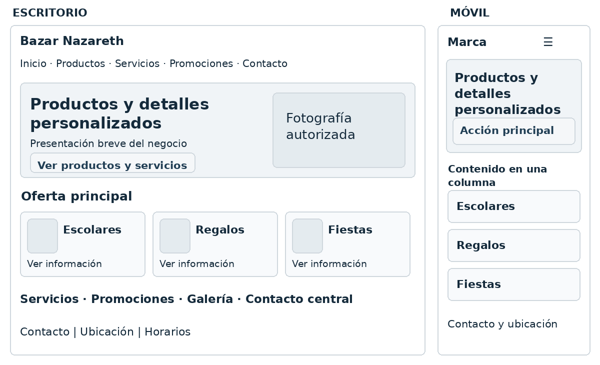
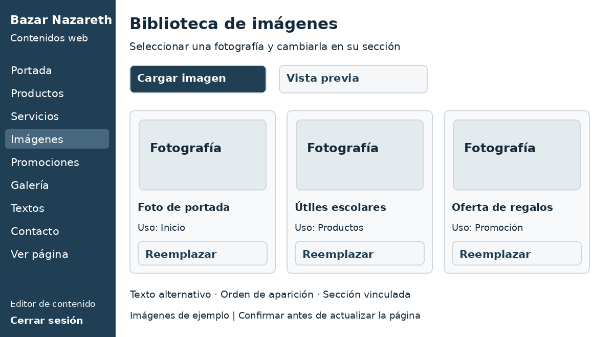
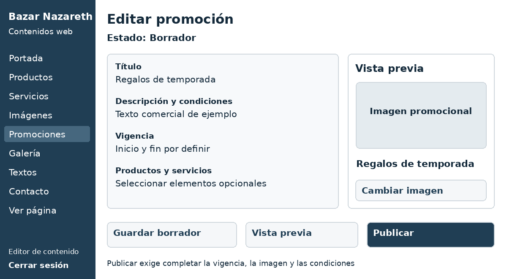

# Bocetos del plan de trabajo

Estos bocetos corresponden al plan de Bazar Nazareth de Hojancha para Programación III. Las imágenes se conservaron tal como aparecen en el documento del proyecto.

## Página pública

## Biblioteca de imágenes

## Editor de promociones

