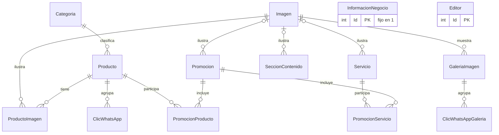

# Modelo y diccionario de datos

Bazar Nazareth de Hojancha guarda el contenido de una sola sede central en SQL Server. El modelo corresponde a `backend/Data/BazarDb.cs` y las entidades de `backend/Modules/`. Las imágenes se guardan en disco. SQL Server conserva el nombre físico y sus metadatos.



`PK` significa clave primaria, `FK` clave foránea y `UQ` índice único. El sufijo `?` indica que la columna admite `NULL`. En las tablas, **texto** corresponde a `nvarchar(max)`, excepto las cadenas que forman parte de una clave o índice, para las que EF usa `nvarchar(450)`. Los importes son `decimal(12,2)`; las fechas de vigencia, `datetimeoffset(7)`.

| Tabla | Columnas y tipos | Restricciones y uso |
| --- | --- | --- |
| `Categoria` | `Id` int; `Nombre` texto; `Orden` int; `Activa` bit | PK `Id`, UQ `Nombre`. Una categoría inactiva oculta sus productos. |
| `Producto` | `Id` int; `CategoriaId` int; `Nombre`, `Descripcion` texto; `precio_informativo` decimal?; `moneda` texto?; `Destacado` bit; `Orden` int; `Estado` texto | PK `Id`, FK `CategoriaId`. Importe no negativo y moneda obligatoria si hay importe. Publicar exige nombre, descripción, categoría activa y foto. |
| `ProductoImagen` | `ProductoId`, `ImagenId`, `Orden` int | PK y FK `(ProductoId, ImagenId)`; cada columna referencia su tabla. UQ `(ProductoId, Orden)`. La primera foto por orden es la principal. |
| `Servicio` | `Id` int; `Nombre`, `Descripcion`, `Alcance` texto; `ImagenId` int?; `precio_desde` decimal?; `moneda` texto?; `Orden` int; `Estado` texto | PK `Id`, FK opcional a `Imagen`. Importe no negativo y moneda obligatoria si hay importe. Publicar exige nombre, descripción y alcance. |
| `Promocion` | `Id` int; `Titulo`, `Descripcion`, `Condiciones` texto; `ImagenId` int?; `Inicio`, `Fin` datetimeoffset?; `Orden` int; `Estado` texto | PK `Id`, FK opcional a `Imagen`. Si ambas fechas existen, `Fin > Inicio`. Publicar exige imagen, ambas fechas y los tres textos. Es pública si `Inicio <= ahora < Fin`. |
| `PromocionProducto` | `PromocionId`, `ProductoId` int | PK compuesta. FKs a `Promocion` y `Producto`. |
| `PromocionServicio` | `PromocionId`, `ServicioId` int | PK compuesta. FKs a `Promocion` y `Servicio`. |
| `Imagen` | `Id` int; `Ruta`, `Nombre`, `TipoMime`, `TextoAlternativo` texto; `TamanoBytes` bigint | PK `Id`. La API genera el nombre físico, valida PNG, JPEG o WebP y limita la carga a 5 MB. `Ruta` identifica el archivo bajo `ImageDirectory`. |
| `SeccionContenido` | `Id` int; `Clave`, `Titulo`, `Cuerpo` texto; `ImagenId` int?; `Orden` int; `Estado` texto | PK `Id`, UQ `Clave`, FK opcional a `Imagen`. La clave `portada` identifica la portada. Publicar exige título y cuerpo. |
| `GaleriaImagen` | `Id`, `ImagenId`, `Orden` int; `Titulo` texto?; `Estado` texto | PK `Id`, UQ `Orden`, FK obligatoria a `Imagen`. Archivar oculta la entrada y conserva su referencia. |
| `InformacionNegocio` | `Id` int; `Nombre`, `Direccion`, `Horario`, `Telefono`, `EnlaceContacto` texto; `Email`, `Redes` texto? | PK `Id` con `CHECK (Id = 1)`. Contacto y pie de página leen el mismo registro. |
| `Editor` | `Id` int; `Nombre`, `Email`, `PasswordHash`, `Permisos` texto; `Activo`, `Completo` bit | PK `Id`, UQ `Email`. La cuenta inicial se crea mediante variables de entorno. Permisos separados por comas cuando `Completo` es falso. |
| `ClicWhatsApp` | `ProductoId` int; `Dia` date; `Origen` texto; `Cantidad` bigint | PK `(ProductoId, Dia, Origen)`, FK a `Producto`. Conteo opcional de clics, desactivado por defecto. |
| `ClicWhatsAppGaleria` | `GaleriaImagenId` int; `Dia` date; `Cantidad` bigint | PK `(GaleriaImagenId, Dia)`, FK a `GaleriaImagen`. Conteo opcional de clics, desactivado por defecto. |

Las fichas, promociones, secciones y entradas de galería usan `Borrador`, `Publicado` y `Archivado`. La API valida esos estados y los valores de orden. `Programada`, `Vigente` y `Finalizada` se calculan a partir de las fechas de la promoción. Las asociaciones de un producto con sus imágenes y de una promoción con sus fichas se guardan en transacciones. La eliminación en cascada se limita a las filas de asociación de un producto o promoción cuando se elimina su ficha principal. Las demás referencias usan eliminación restringida.

El arranque crea el esquema para una base vacía mediante `EnsureCreatedAsync()`. Para obtener el script de creación del mismo modelo sin conectarse a SQL Server, ejecute desde la raíz del repositorio:

```powershell
dotnet build tests/CatalogChecks
dotnet run --project tests/CatalogChecks --no-build -- --schema > esquema-bazar.sql
```

El script generado está destinado a una base vacía. El mapa documenta el esquema actual, que todavía carece de las columnas de auditoría de edición previstas en el plan. `sql/schema.sql` consulta cuentas. Para preparar contenido de prueba, siga el [manual de edición y demostración](manual-edicion.md).
